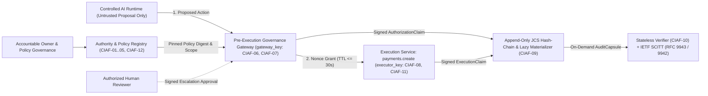

# CIAF-LCM v0.1.1 Reference Repository

> **CIAF-LCM v0.1.1 • Public Comment Draft (Open through February 10, 2027)** — *Wire schemas retain `"schema_version": "0.1.0"` for deterministic v0.1.x cryptographic compatibility.*

**Cognitive Insight Audit Framework – Lazy Capsule Materialization (`ciaf-lcm-reference`)**  
*Vendor-Neutral Reference Architecture, Control Catalog, Interoperability Profile, and Adversarial Assurance Suite for Consequential AI & Agentic Systems*

[](https://github.com/DenzilGreenwood/ciaf-lcm-reference/actions/workflows/verify.yml)
[](https://denzilgreenwood.github.io/ciaf-lcm-reference/)
[](LICENSE-SPEC)
[](LICENSE-CODE)
[](pyproject.toml)

---

## Public Mission Statement

Modern AI and agentic systems increasingly invoke consequential enterprise tools—initiating payments, modifying clinical or operational records, and adjudicating regulated workflows. Traditional logging treats model prompts, chain-of-thought traces, or application logs as retrospective audit evidence, conflating **what a model proposed** with **what an organization authorized**.

**CIAF-LCM** establishes an open, vendor-neutral governance and cryptographic assurance standard built on a non-negotiable architectural invariant:

> **An AI model or agent may propose an action, but execution authority MUST originate from a separately governed Pre-Execution Governance Gateway. Model output is never proof of authorization.**

By pairing **low-latency pre-execution cryptographic grants** with **Lazy Capsule Materialization (LCM)**, organizations capture lightweight RFC 8785 canonical receipts on the critical path and materialize self-contained, zero-trust `AuditCapsule` bundles only when demanded by auditors, regulators, incident responders, or automated assurance pipelines.

---

## The Four Essential Assurance Questions

Every artifact in `ciaf-lcm-reference` is engineered to let an independent third party deterministically answer four questions without trusting the AI model, prompt state, or runtime operator:

1. **Authority & Accountability**: *Did the Authority & Policy Registry cryptographically attest (`REGISTRY_AUTHORITY` `authority_attestation`) and bind a `delegated_scope_snapshot` proving that this agent held active, unrevoked, least-privilege delegation (including exact ISO-4217 integer `amount_minor_units` ceilings) under a pinned policy—and does the attested human `accountable_owner` reconcile to enterprise HR/IAM governance records?* (`CIAF-01`–`CIAF-05`, `CIAF-12`)
2. **Pre-Execution Governance & Signed Human Escalation**: *Did a separately keyed, fail-closed Governance Gateway evaluate the exact canonical request prior to execution—and where risk or monetary thresholds required escalation, did an authorized human reviewer independently sign over the `request_digest` (`HUMAN_REVIEWER` key)?* (`CIAF-06`, `CIAF-07`)
3. **Boundary Enforcement & Anti-Tampering**: *Did the downstream Execution Service enforce a short-lived (`<= 30s` default policy-bounded TTL), single-use, payload-bound cryptographic grant—blocking direct bypasses, replays, in-flight revocations, and TOCTOU mutations before any side effect occurred?* (`CIAF-08`, `CIAF-11`, `CIAF-12`)
4. **Stateless Verifiability, Trusted Time & Completeness**: *Can an offline stateless verifier possessing only the `AuditCapsule` and a trusted public key manifest validate role-pinned Ed25519 signatures, RFC 8785 canonical digests, `delegated_scope_snapshot` bounds, hash-chain continuity, and optional IETF SCITT (`RFC 9943` / `RFC 9942` COSE Receipts) + `RFC 3161` TSA anchors for external non-omission and trusted timestamping?* (`CIAF-09`, `CIAF-10`)

---

## Five-Layer Conceptual Separation

CIAF-LCM strictly separates five layers across all specifications, JSON Schemas, and code:

```text
Capability  !=  Authority  !=  Authorization  !=  Execution  !=  Assurance
```

| Layer | Question Answered | Governing Plane | Normative Artifact |
| :--- | :--- | :--- | :--- |
| **Capability** | What *can* a model or tool technically formulate or invoke? | AI/Agent Runtime | Untrusted `proposed_action` |
| **Authority** | What is the agent *delegated* to propose on behalf of an accountable owner? | Authority & Policy Registry (`CIAF-01`–`CIAF-05`, `CIAF-12`) | Pinned `policy_snapshot` & delegation record |
| **Authorization** | Is *this specific request* permitted right now under pinned policy or human sign-off? | Pre-Execution Governance Gateway (`CIAF-06`, `CIAF-07`) | Gateway-signed `AuthorizationClaim` + `ExecutionGrant` |
| **Execution** | Was the grant verified, and what side effect (or security block) occurred? | Execution Service (`CIAF-08`, `CIAF-11`) | Executor-signed `ExecutionClaim` |
| **Assurance** | Does independent cryptographic verification prove control integrity? | Independent Verifier & SCITT Log (`CIAF-09`, `CIAF-10`) | `AuditCapsule` + `AssuranceClaim` |

---

## Architectural Overview



### Runtime Interoperability & Reference Adapters

CIAF-LCM is strictly vendor-neutral. Any orchestrator, service mesh, MCP tool proxy, API gateway, or governance runtime—such as open-source Envoy/OPA sidecars, custom enterprise middleware, `AGEI` (*Agentic Governance & Execution Interface*), or cleanroom Python/TypeScript runtimes (see [`examples/independent_producer.py`](examples/independent_producer.py))—conforms to CIAF-LCM v0.1 when its emitted `AuditCapsule` bundles pass independent verification against the published Draft 2020-12 schemas and cryptographic rules.

---

## Repository Layout

```text
ciaf-lcm-reference/
├── README.md                                        # Mission, architecture, quickstart, dual license notice
├── LICENSE                                          # Dual-license overview linking LICENSE-CODE & LICENSE-SPEC
├── LICENSE-CODE                                     # Apache License 2.0 (schemas, code, tests, web app)
├── LICENSE-SPEC                                     # CC-BY-4.0 summary, deed URL & attribution rules (specs)
├── CONTRIBUTING.md                                  # Vendor-neutral adapter & crosswalk contribution rules
├── SECURITY.md                                      # Private cryptographic & boundary disclosure policy
├── .github/
│   ├── workflows/verify.yml                         # Python pytest + Web Crypto interop + static HTML CI
│   ├── workflows/pages.yml                          # Auto-deploy static index.html & spec pages to GitHub Pages
│   ├── ISSUE_TEMPLATE/                              # Structured RFC public comment & adapter interop forms
│   ├── PULL_REQUEST_TEMPLATE.md                     # 6-invariant PR checklist & dual-license verification
│   └── CODEOWNERS                                   # Automatic maintainer review assignment
├── pyproject.toml                                   # Python 3.11+ package & pytest configuration
├── docs/
│   ├── reference-architecture-v0.1.md               # 6-plane normative architecture & 6-vector threat model
│   ├── vocabulary-v0.1.md                           # 12 core terms + 5-layer conceptual separation
│   └── audit-readiness-methodology-v0.1.md          # 6-step assessment, 2-axis rubric, 3 industry profiles
├── controls/
│   └── ciaf-control-catalog-v0.1.md                 # Normative definitions for CIAF-01 through CIAF-12
├── standards-crosswalks/
│   ├── nist-ai-rmf-crosswalk-v0.1.md                # NIST AI RMF 1.0 Govern/Map/Measure/Manage alignment
│   ├── iso-42001-crosswalk-v0.1.md                  # ISO/IEC 42001:2023 Clauses 4-10 & Annex A alignment
│   └── ietf-scitt-profile-v0.1.md                   # IETF SCITT (RFC 9943) COSE_Sign1 & Merkle inclusion profile
├── schemas/
│   ├── authorization-claim.v0.1.schema.json         # Draft 2020-12 schema for Gateway AuthorizationClaim
│   ├── execution-claim.v0.1.schema.json             # Draft 2020-12 schema for Executor ExecutionClaim
│   ├── assurance-claim.v0.1.schema.json             # Draft 2020-12 schema for Verifier AssuranceClaim
│   └── audit-capsule.v0.1.schema.json               # Draft 2020-12 schema for lazily materialized AuditCapsule
├── reference-implementation/python/ciaf_lcm/        # Reference Python 3.11+ library (RFC 8785 + Ed25519)
├── examples/
│   └── independent_producer.py                      # Cleanroom zero-ciaf_lcm-import producer script
├── tests/                                           # Positive, adversarial security, and interop pytest suite
└── apps/verifier-sandbox/                           # Zero-backend Next.js + Web Crypto Ed25519 Inspector UI
```

---

## Quickstart Commands

### 1. Python Reference Implementation & Adversarial Test Suite

```powershell
# Create virtual environment and install dependencies
python -m venv .venv
.\.venv\Scripts\pip install -e ".[dev]"

# Run the complete positive, adversarial, and cleanroom interoperability test suite
.\.venv\Scripts\pytest -v

# Execute the 4 end-to-end CLI governance & verification flows (ALLOW, DENY, ESCALATE, REVOKED)
.\.venv\Scripts\python -m ciaf_lcm.cli_demo

# Emit a cleanroom independent AuditCapsule with zero ciaf_lcm imports
.\.venv\Scripts\python examples/independent_producer.py
```

### 2. Static HTML Export & Interactive Verifier (`apps/verifier-sandbox`)

```powershell
cd apps/verifier-sandbox
npm install
# Exports static HTML into out/ (index.html, specs/*/index.html, schemas/index.html, contribute/index.html)
npm run build
npm run dev
```

Open `http://localhost:3000` (or the hosted GitHub Pages build at `https://denzilgreenwood.github.io/ciaf-lcm-reference/`) to inspect the live Stateless Ed25519 Receipt Verifier (`out/index.html`), browse rendered normative specifications (`/specs/`), explore Draft 2020-12 JSON Schemas (`/schemas/`), and submit structured public comments (`/contribute/`).

---

## Dual-Licensing Notice

This repository is dual-licensed to maximize open standards adoption and software interoperability:

- **Normative Specifications, Control Catalog, and Standards Crosswalks** (`docs/`, `controls/`, `standards-crosswalks/`): Licensed under the **Creative Commons Attribution 4.0 International License (`CC-BY-4.0`)**. See [`LICENSE-SPEC`](LICENSE-SPEC).
- **JSON Schemas, Reference Implementations, Examples, Test Suites, and Verifier Applications** (`schemas/`, `reference-implementation/`, `examples/`, `tests/`, `apps/`): Licensed under the **Apache License, Version 2.0 (`Apache-2.0`)**. See [`LICENSE-CODE`](LICENSE-CODE).

