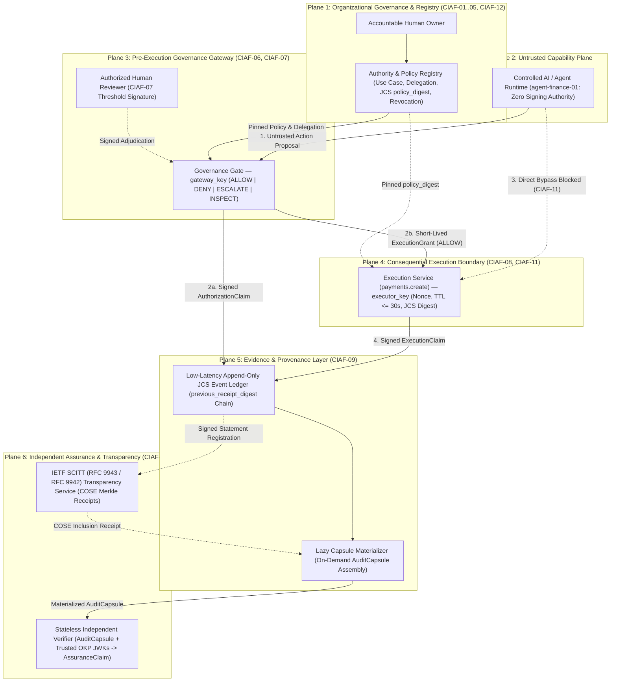

# CIAF-LCM v0.1 Normative Reference Architecture

**Document ID**: `CIAF-LCM-ARCH-v0.1.1`  
**Status**: Normative Specification (`v0.1.1` — Public Comment Draft through February 10, 2027)  
**License**: Creative Commons Attribution 4.0 International (`CC-BY-4.0` — see [`LICENSE-SPEC`](../LICENSE-SPEC))

---

## 1. Scope & Normative Mandate

This specification defines the vendor-neutral **Cognitive Insight Audit Framework – Lazy Capsule Materialization (CIAF-LCM) v0.1** reference architecture for governing consequential actions proposed by AI models and autonomous or semi-autonomous software agents.

### 1.1 Foundational Architectural Rule
An AI model, prompt chain, or agent runtime `MAY` propose a consequential tool invocation, but execution authority `MUST` originate exclusively from a separately governed **Pre-Execution Governance Gateway**. Model reasoning traces, tool-call outputs, or agent state `MUST NEVER` be accepted by a downstream service as proof of authorization.

### 1.2 Layer Separation Invariant
Every component, wire protocol, schema, and audit procedure `MUST` enforce the five-layer boundary defined in [`vocabulary-v0.1.md`](vocabulary-v0.1.md):

```text
Capability  !=  Authority  !=  Authorization  !=  Execution  !=  Assurance
```

---

## 2. Six-Plane Reference Architecture

CIAF-LCM partitions AI tool governance and assurance into six distinct functional planes separated by explicit cryptographic and network trust boundaries.

### 2.1 Mermaid Trust-Boundary Architecture



### 2.2 ASCII Trust-Boundary View

```text
+-----------------------------------------------------------------------------------+
| TRUST ZONE A: ORGANIZATIONAL GOVERNANCE & REGISTRY (CIAF-01..05, CIAF-12)         |
|  [Accountable Owner] ---> [Authority & Policy Registry: pinned JCS policy_digest] |
+-----------------------------------------+-----------------------------------------+
                                          | (Read-Only Authority & Kill-Switch State)
                                          v
+-----------------------------------+     +-----------------------------------------+
| TRUST ZONE B: CAPABILITY RUNTIME  |     | TRUST ZONE C: PRE-EXECUTION GATEWAY     |
|  [Controlled AI / Agent Runtime]  |---->|  [Governance Gateway (CIAF-06, CIAF-07)]|
|  - Proposes tool_name + params    |  1  |  - Key: gateway_key (Ed25519 OKP JWK)   |
|  - Holds ZERO grant signing keys  |     |  - Decisions: ALLOW|DENY|ESCALATE|INSPECT|
+-----------------+-----------------+     +--------------------+--------------------+
                  |                                            |
   (Direct Bypass | BLOCKED: CIAF-11)        2. ExecutionGrant | (TTL<=30s, 1-use nonce,
    Attempt)      |                             + AuthzClaim   |  bound_request_digest)
                  v                                            v
+-----------------------------------------------------------------------------------+
| TRUST ZONE D: EXECUTION SERVICE BOUNDARY (CIAF-08, CIAF-11)                       |
|  [Execution Service: payments.create]                                             |
|  - Key: executor_key (Ed25519 OKP JWK; executor_key != gateway_key)               |
|  - Enforces Gateway signature, <=30s TTL, single-use nonce, JCS request_digest    |
+-----------------------------------------+-----------------------------------------+
                                          | 3. Append Signed Receipts (Low-Latency)
                                          v
+-----------------------------------------------------------------------------------+
| TRUST ZONE E: PROVENANCE LEDGER, LAZY CAPSULE MATERIALIZER & SCITT (CIAF-09..10)  |
|  [Append-Only Hash-Chain] --> [Lazy Capsule Materializer] --> [Stateless Verifier]|
|                           \-> [IETF SCITT RFC 9943/9942]  --> [AssuranceClaim]    |
+-----------------------------------------------------------------------------------+
```

---

## 3. Component Specifications

### 3.1 Organizational Governance & Authority Registry (`CIAF-01`–`CIAF-05`, `CIAF-12`)
1. **Use Case, Owner & Signed Registry Attestation (`CIAF-01`, `CIAF-02`)**: Every agent deployment `MUST` reference an active `use_case_id` with a documented `business_purpose`, risk classification, and named human `accountable_owner`. To prevent a compromised Gateway from misrepresenting standing authority in offline verification, the Registry `SHOULD` hold an independent `REGISTRY_AUTHORITY` Ed25519 keypair and export a signed `authority_attestation` snapshot (`use_case`, `agent`, `delegation`, `signature`, `attestation_digest`) into `AuditCapsule` bundles. Note that cryptographic registry attestation proves what the Registry recorded at `attested_at`; confirming that the human `accountable_owner` held genuine institutional standing still requires periodic reconciliation with enterprise HR/IAM governance records.
2. **Workload Agent Identity (`CIAF-03`)**: Each agent instance `MUST` possess a distinct `agent_id` bound to verifiable workload metadata (`workload_id`, `model_profile`).
3. **Domain-Neutral Scoped Delegation, ISO-4217 Integer Minor Units & Velocity Caps (`CIAF-04`)**: Standing authority `MUST` specify explicit `allowed_tools` and domain-neutral parameter bounds (`scope_constraints`, `escalate_on_tools`, counterparty allowlists/watchlists). Where monetary value is delegated, thresholds and request amounts `MUST` be represented as **exact ISO-4217 integer minor currency units** (`amount_minor_units`, `currency`, and integer `minor_unit_scale` `0..18`—for example `45000`, `"USD"`, `2` for `\$450.00`); bare `"amount"` fields or IEEE-754 floating-point monetary values `MUST` be rejected (`INVALID_MONETARY_PRECISION`). Financial delegations `SHOULD` configure rolling cumulative velocity controls (`rolling_window_max_amount`, `rolling_window_max_count`, `rolling_window_seconds`) to block structuring or split-payment attacks below per-transaction escalation thresholds.
4. **Canonical Policy Digest Pinning (`CIAF-05`)**: Policies `MUST` be canonicalized per RFC 8785 prior to computing `policy_digest` (`sha256:<hex>`).
5. **Emergency Revocation & Residual TTL Window (`CIAF-12`)**: Transitioning an `agent_id` or `delegation_id` to `REVOKED` `MUST` immediately block new grant issuance at the Pre-Execution Governance Gateway without model retraining or redeployment. Deployments relying solely on stateless grant verification retain a bounded residual exposure window equal to the active grant TTL (`<= 30s` by default) for grants minted immediately prior to revocation; deployments requiring **zero-window revocation** `MUST` wire a synchronous revocation feed (`is_agent_revoked`) into the Execution Service to block unexpired in-flight grants (`AUTHORITY_REVOKED_IN_FLIGHT`).

### 3.2 Controlled AI / Agent Runtime (Untrusted Capability Layer)
The Controlled AI / Agent Runtime hosts model inference, planning loops, and tool-invocation adapters. Because language and multimodal models remain susceptible to prompt injection, indirect context poisoning, and stochastic hallucination, CIAF-LCM treats the runtime strictly as an **untrusted proposer**:
- The runtime `MUST NOT` hold private keys capable of minting `AuthorizationClaim`, `ExecutionGrant`, `HumanReviewDecision`, or `ExecutionClaim` objects.
- Network routing, service-mesh mTLS policies, and Execution Service authentication `MUST` prevent the runtime from executing consequential side effects without presenting a valid Gateway `ExecutionGrant`.

### 3.3 Pre-Execution Governance Gateway (`CIAF-06`, `CIAF-07`)
The Pre-Execution Governance Gateway `MUST` operate **fail-closed**: any missing registry context, bare `"amount"` or float monetary ambiguity, velocity cap breach, untrusted signature, or unexpected internal evaluation exception (`GATEWAY_INTERNAL_FAIL_CLOSED`) `MUST` resolve to `DENY` with `execution_grant: null`. Every evaluation emits a signed `AuthorizationClaim` embedding a `delegated_scope_snapshot` (`accountable_owner`, `allowed_tools`, `max_auto_amount_minor_units`, `escalation_max_amount_minor_units`, `currency`, `revoked`) inside `authority_context` and recording one of four normative outcomes:
- **`ALLOW`**: Proposal satisfies active authority, policy digest pinning, domain/monetary scope, cumulative velocity caps, and—where required—cryptographically signed human review (`CIAF-07`) or compliance clearance (`INSPECTION_CLEARED`). The Gateway `MUST` mint an `execution_grant` containing a CSPRNG `nonce` (>= 128 bits entropy), `issued_at`, `expires_at` (`ttl_seconds <= 30` by default, bounded by pinned `policy_document.grant_max_ttl_seconds` up to an absolute protocol ceiling of `300s`), `target_service`, `bound_agent_id`, `bound_tool_name`, `bound_request_digest`, `bound_policy_digest`, `bound_authorization_claim_id`, and `gateway_grant_signature`.
- **`DENY`**: Proposal violates revocation/suspension status, tool/domain scope, monetary precision or ceiling, cumulative velocity cap, policy digest pinning, compliance inspection (`INSPECTION_BLOCKED`), or human review adjudication. `execution_grant` `MUST` be `null`.
- **`ESCALATE`**: Proposal exceeds `autonomous_max_amount` or invokes a tool in `escalate_on_tools` (`CIAF-07`). `execution_grant` `MUST` remain `null` (`ESCALATION_REQUIRED_PENDING_REVIEW`) until an authorized reviewer signs `{proposal_id, request_digest, policy_digest, reviewer_id, approved, review_rationale, reviewed_at}` using an independent `HUMAN_REVIEWER` Ed25519 key (for example, hardware-backed WebAuthn/HSM signing), preventing a compromised Gateway from fabricating human approval (`reviewer_signature`).
- **`INSPECT`**: Proposal matches a compliance watchlist (`INSPECTION_REQUIRED`), holding execution (`execution_grant: null`) until an authorized compliance inspector submits a clearance determination resolving to `ALLOW` (`INSPECTION_CLEARED`) or `DENY` (`INSPECTION_BLOCKED`).

### 3.4 Downstream Execution Service (`CIAF-08`, `CIAF-11`, `CIAF-12`)
The Execution Service hosts consequential enterprise operations (such as `payments.create` or `ehr.medication_order.submit`) and `MUST` enforce a strict **Dual-Key Trust Boundary**:
1. **Key Independence**: The Execution Service `MUST` generate and protect its own Ed25519 private key (`executor_key`, `role: EXECUTION_SERVICE`) completely isolated from `gateway_key`, `registry_key`, and `reviewer_key`. It `MUST` receive only the Gateway's public verification key.
2. **Pre-Handler Enforcement Sequence**: Prior to invoking the consequential tool handler (`execution.attempted` remains `false` during checks), the Execution Service `MUST` verify:
   - Presence of `execution_grant`, `authorization_claim_id`, and `authorization_claim_digest` (blocking direct gateway bypasses under `CIAF-11`);
   - Cryptographic validity of `gateway_grant_signature` over the RFC 8785 canonical grant body against a trusted Gateway public key;
   - Non-membership of `nonce` in the service's atomic consumed-nonce store (anti-replay);
   - Temporal validity (`issued_at <= now <= expires_at` and `ttl_seconds <= max_accepted_ttl_seconds`);
   - Exact match of `bound_agent_id`, `bound_tool_name`, `target_service`, `bound_authorization_claim_id`, and pinned `bound_policy_digest`;
   - Exact equality between freshly computed `observed_request_digest = sha256(JCS({tool_name, operation, parameters}))` and `bound_request_digest` (TOCTOU payload-mutation prevention); and
   - Where zero-window revocation is enabled (`CIAF-12`), synchronous confirmation that `agent_id` has not been revoked in flight (`AUTHORITY_REVOKED_IN_FLIGHT`).
3. **Receipt Emission & Gateway-Blocked Optionality**: Whenever a request reaches the Execution Service—whether it succeeds (`SUCCEEDED`) or is blocked as a runtime security exception (`REJECTED_SECURITY_EXCEPTION`)—the Execution Service `MUST` emit an enveloped Ed25519-signed `ExecutionClaim`. When a proposal is blocked upstream at the Gateway (`DENY`, pending `ESCALATE`, or pending `INSPECT`) and never transmitted to the Execution Service, an `AuditCapsule` with `execution_claims: []` is normatively valid (`ASSURED_GOVERNANCE_BLOCK`); co-monitored pipelines `MAY` optionally append a `NOT_ATTEMPTED_GATEWAY_BLOCKED` attestation receipt.

### 3.5 Evidence & Provenance Layer: Low-Latency Capture, Salted Commitments & Lazy Materialization (`CIAF-09`)
CIAF-LCM decouples **runtime capture** from **audit materialization**:
1. **Hot Path (Low-Latency Append-Only Capture)**: During execution, the Gateway and Execution Service append compact, pre-signed JSON claims (`AuthorizationClaim`, `ExecutionClaim`) to an append-only ledger partitioned or indexed by `workflow_trace_id`. Each receipt commits to its predecessor via `previous_receipt_digest = prior.claim_digest` (`null` at `sequence_number == 0`), where `claim_digest = sha256(JCS(claim_body_with_signature))`.
2. **Low-Entropy Regulated Payload Protection**: Because unsalted SHA-256 digests over small or predictable parameter domains (e.g., medical record numbers, ICD-10 codes, or boolean flags) are vulnerable to offline dictionary brute-force if published to external transparency logs, regulated deployments `MUST` bind `>= 128-bit` random salts (`jcs_salted_commitment`) or keyed `HMAC-SHA256` commitments (`jcs_hmac_sha256`) when externalizing redacted digests, retaining salt/key disclosure strictly inside access-controlled `AuditCapsule` vaults.
3. **Cold / On-Demand Path (Lazy Capsule Materialization)**: Only when an audit query, regulatory examination, security alert, or automated CI assurance check requests evidence for `workflow_trace_id` does the **Lazy Capsule Materializer** assemble a self-contained `AuditCapsule` combining `policy_snapshot`, optional `authority_attestation`, `public_key_manifest`, `hash_chain`, `authorization_claims`, `execution_claims`, `scitt_transparency`, and `capsule_digest`.

### 3.6 Stateless Independent Verifier, Trusted Time & SCITT Completeness (`CIAF-10`)
A Stateless Independent Verifier `MUST` operate with **zero shared runtime state** and **zero access to private keys**. Taking only an `AuditCapsule` and an out-of-band trusted OKP JWK key manifest (`trusted_keys`), it executes in strict envelope order:
1. Validate the complete wire JSON against Draft 2020-12 JSON Schemas (`audit-capsule`, `authorization-claim`, `execution-claim`);
2. Recompute `claim_digest == sha256(JCS(body_with_signature))` on every receipt, `attestation_digest` on `authority_attestation` (if present), and `capsule_digest` on the capsule;
3. Strip `signature` and `claim_digest` to verify `Ed25519.verify(JCS(unsigned_body))` against role-pinned keys (`PRE_EXECUTION_GOVERNANCE_GATEWAY`, `EXECUTION_SERVICE`, `REGISTRY_AUTHORITY`, and `HUMAN_REVIEWER`) in `trusted_keys`, ensuring zero shared key material across roles;
4. Independently enforce `authority_context.delegated_scope_snapshot` numeric, currency, tool, and revocation bounds on every `ALLOW` claim (`UNESCALATED_ALLOW_ABOVE_AUTONOMOUS_LIMIT`, `ALLOW_EXCEEDS_DELEGATED_CEILING`), validate optional `REGISTRY_AUTHORITY` `authority_attestation` consistency against Gateway claims, verify `HUMAN_REVIEWER` signatures over escalated `ALLOW` claims, check policy-bounded grant TTL windows, single-use nonce uniqueness, `previous_receipt_digest` hash-chain continuity, and semantic decision-to-execution consistency, outputting a schema-valid `AssuranceClaim`.
5. **Trusted Time Scope Boundary**: In purely offline local-chain verification, `issued_at`, `expires_at`, and `ExecutionClaim.timestamp` check chronological consistency across issuer-asserted Gateway and Executor clocks; cryptographic defense against compromised-executor or colluding clock backdating requires external timestamp anchoring via **RFC 3161 Time-Stamp Authority (TSA)** tokens or **IETF SCITT (`RFC 9943` / `RFC 9942` COSE Receipts)** Transparency Service registration timestamps.

---

## 4. Cryptographic Serialization & Envelope Specification

1. **Canonicalization (`RFC 8785 / JCS`)**: All JSON structures hashed or signed in CIAF-LCM `MUST` be serialized per **RFC 8785**:
   - No insignificant whitespace;
   - IEEE-754 binary64 numbers formatted per ECMA-262 `Number::toString` (`-0.0` serialized as `"0"`, `NaN` and `Infinity` rejected);
   - Object member keys sorted lexicographically by **UTF-16 code units** (ensuring supplementary Unicode characters `U+10000..U+10FFFF` encoded as surrogate pairs `0xD800..0xDFFF` sort identically across Python, Go, Rust, and ECMAScript/TypeScript).
2. **Public Key Representation (`RFC 8037 OKP JWK`)**: Public keys in `public_key_manifest` and `trusted_keys` `MUST` be represented as role-tagged OKP JWKs (`kty: "OKP"`, `crv: "Ed25519"`, `x: "<43-char-unpadded-base64url>"`) paired with `key_id`, `role`, and `status`, ensuring deterministic import across Python `cryptography`, OpenSSL, and browser/Node `SubtleCrypto` without ASN.1 DER ambiguity.

---

## 5. Normative Threat Model

| Threat Vector | Adversary Capability & Goal | Mitigating Controls & Architectural Defense | Residual Boundary / Limitation |
| :--- | :--- | :--- | :--- |
| **T1: Direct Gateway Bypass** | Prompt-injected or compromised agent runtime invokes `payments.create` directly on the Execution Service, skipping Gateway evaluation. | **`CIAF-06`, `CIAF-08`, `CIAF-11`**: Execution Service requires a Gateway-signed `ExecutionGrant` before setting `execution.attempted = true`; missing grants trigger deterministic containment (`DIRECT_GATEWAY_BYPASS`) and an immutable `ExecutionClaim` security exception receipt. | Underlying host/database credentials backing `payments.create` must also be network-isolated from the agent container. |
| **T2: Agent or Reviewer Impersonation** | Unauthorized workload spoofs `agent-finance-01` or submits unauthenticated human approval on an `ESCALATE` decision. | **`CIAF-03`, `CIAF-07`, `CIAF-08`**: Workload attestation binds `agent_id` (`bound_agent_id`); Gateway checks `authorized_human_reviewers` before transitioning `ESCALATE -> ALLOW`. | Relies on upstream enterprise IdP/workload identity (e.g., SPIFFE/SVID or hardware-backed WebAuthn for human reviewers). |
| **T3: Grant Replay & TOCTOU Payload Mutation** | Attacker reuses a captured valid `ALLOW` grant for a second payment, or obtains a grant for `\$450.00` (`45000` minor units) and mutates the executor call payload to `\$45,000.00` (`4500000` minor units). | **`CIAF-08`, `CIAF-11`**: Single-use `nonce` tracking rejects replays (`GRANT_NONCE_REPLAY`); `<= 30s` TTL bounds exposure (`GRANT_TTL_EXPIRED`); freshly computed `observed_request_digest` rejects `45000 -> 4500000` mutations (`TOCTOU_PAYLOAD_TAMPER`). | In multi-replica executors, the consumed-nonce store `MUST` use atomic distributed compare-and-set (`SET NX EX`); defending against compromised-executor clock backdating requires external `RFC 3161` TSA or `IETF SCITT (RFC 9943 / RFC 9942)` timestamps. |
| **T4: Post-Hoc Evidence Mutation** | Insider or attacker modifies a saved JSON receipt (e.g., altering `invoice_id` or `settled_amount_minor_units`) or reformats JSON whitespace/key order. | **`CIAF-09`, `CIAF-10`**: RFC 8785 canonicalization tolerates benign whitespace/key-order changes while invalidating `signed_payload_digest`, Ed25519 signatures, and `claim_digest` on any semantic mutation. | Does not prevent deletion of an entire unanchored ledger unless externalized (see T5). |
| **T5: Selective Log Omission / Truncation** | Operator deletes an intermediate escalation receipt or truncates the tail of a local event stream before handing a capsule to auditors. | **`CIAF-09`, `CIAF-10`**: `previous_receipt_digest` + contiguous `sequence_number` checks deterministically catch **mid-chain deletion or reordering**. Tail-omission / completeness proofs require **IETF SCITT (`RFC 9943` / `RFC 9942` COSE Receipts)** Merkle inclusion receipts. | Local hash-chaining alone **cannot** detect whole-stream suppression or tail truncation if the operator controls ledger storage and has not anchored tips externally. |
| **T6: Single-Key Compromise / Cross-Role Forgery** | Compromised Gateway attempts to fabricate proof of execution, forge human escalation approval, or lie about revoked registry standing; or compromised Executor attempts to self-authorize an unapproved payment. | **`CIAF-01`, `CIAF-07`, `CIAF-08`, `CIAF-10`**: Multi-role OKP JWK separation (`PRE_EXECUTION_GOVERNANCE_GATEWAY`, `EXECUTION_SERVICE`, `REGISTRY_AUTHORITY`, `HUMAN_REVIEWER`). Cross-role or unsigned approvals/executions fail independent verification (`TRUST_BOUNDARY_KEY_ROLE_VIOLATION`, `FORGED_OR_UNSIGNED_HUMAN_APPROVAL`, `GATEWAY_REGISTRY_ATTESTATION_CONFLICT`). | Simultaneous compromise of all independent HSM/KMS security domains requires root governance key rotation and external SCITT tree audit. |

---

## 6. Normative Reason-Code & Exception-Code Registry

Conformant Gateways, Execution Services, and Independent Verifiers `SHOULD` emit the standardized machine-readable reason and exception codes below so cross-vendor SIEM, GRC, and audit tools can parse dispositions deterministically.

### 6.1 Gateway `AuthorizationClaim.decision.reason_code` Registry

| `reason_code` | `outcome` | Primary Control | Normative Meaning |
| :--- | :---: | :---: | :--- |
| `WITHIN_DELEGATED_AUTHORITY` | `ALLOW` | `CIAF-06` | Proposal satisfies active delegation, pinned policy, and autonomous velocity/amount limits. |
| `ESCALATED_HUMAN_APPROVED` | `ALLOW` | `CIAF-07` | Threshold/tool escalation approved with valid `HUMAN_REVIEWER` signature over `request_digest`. |
| `INSPECTION_CLEARED` | `ALLOW` | `CIAF-06` | Watchlist hold cleared by an authorized compliance inspector within delegated scope. |
| `ESCALATION_REQUIRED_PENDING_REVIEW` | `ESCALATE` | `CIAF-07` | Proposal exceeds autonomous threshold or matches `escalate_on_tools`; awaits human signature. |
| `INSPECTION_REQUIRED` | `INSPECT` | `CIAF-06` | Counterparty or parameter matches compliance watchlist; held pending inspection. |
| `AUTHORITY_REVOKED` | `DENY` | `CIAF-12` | Agent identity or delegation status is `REVOKED`. |
| `AUTHORITY_SUSPENDED` | `DENY` | `CIAF-01` / `CIAF-12` | Agent, delegation, or parent `use_case_id` is `SUSPENDED` or `RETIRED`. |
| `POLICY_DIGEST_MISMATCH` | `DENY` | `CIAF-05` | Expected policy digest does not match active RFC 8785 `policy_digest`. |
| `TOOL_NOT_ALLOWED` | `DENY` | `CIAF-04` | Proposed `tool_name` is outside `allowed_tools`. |
| `SCOPE_CONSTRAINT_VIOLATION` | `DENY` | `CIAF-04` | Domain parameter violates delegated `scope_constraints`. |
| `INVALID_MONETARY_PRECISION` | `DENY` | `CIAF-04` | Monetary parameter used bare `"amount"`, IEEE-754 float, or invalid `minor_unit_scale` instead of exact ISO-4217 integer `amount_minor_units`. |
| `INVALID_PARAMETER_AMOUNT` | `DENY` | `CIAF-04` | Monetary parameter is non-positive, boolean, or non-integer. |
| `CURRENCY_NOT_ALLOWED` | `DENY` | `CIAF-04` | Proposed `currency` is outside `allowed_currencies`. |
| `BENEFICIARY_NOT_ALLOWED` | `DENY` | `CIAF-04` | Counterparty is absent from `allowed_beneficiaries`. |
| `AUTHORITY_SCOPE_EXCEEDED` | `DENY` | `CIAF-04` / `CIAF-06` | Proposed amount exceeds `escalation_max_amount` outer delegation ceiling. |
| `CUMULATIVE_VELOCITY_EXCEEDED` | `DENY` | `CIAF-04` / `CIAF-06` | Rolling cumulative grant amount or count exceeds anti-structuring window cap. |
| `UNAUTHORIZED_HUMAN_REVIEWER` | `DENY` | `CIAF-07` | `reviewer_id` is not listed in `authorized_human_reviewers`. |
| `ESCALATION_REJECTED_BY_REVIEWER` | `DENY` | `CIAF-07` | Authorized human reviewer explicitly rejected the escalated proposal. |
| `INVALID_HUMAN_REVIEW_SIGNATURE` | `DENY` | `CIAF-07` | Missing, untrusted, or cryptographically invalid `HUMAN_REVIEWER` signature. |
| `UNAUTHORIZED_COMPLIANCE_INSPECTOR` | `DENY` | `CIAF-06` | `inspector_id` is not authorized to clear `INSPECT` holds. |
| `INSPECTION_BLOCKED` | `DENY` | `CIAF-06` | Compliance inspection denied clearance for the held proposal. |
| `GATEWAY_INTERNAL_FAIL_CLOSED` | `DENY` | `CIAF-06` | Defensive fail-closed denial triggered by an unexpected internal evaluation error. |

### 6.2 Execution Service `grant_verification_status` & `security_exception.exception_code` Registry

| `grant_verification_status` | `exception_code` | Primary Control | Normative Meaning |
| :--- | :--- | :---: | :--- |
| `VERIFIED` | *(none — `null`)* | `CIAF-08` | Grant signature, nonce, TTL, policy digest, caller, and `observed_request_digest` verified. |
| `NOT_PRESENTED_PRE_BLOCKED` | *(none — `null`)* | `CIAF-06` | Optional co-monitored receipt confirming no execution was attempted after Gateway block. |
| `MISSING_BYPASS_ATTEMPT` | `DIRECT_GATEWAY_BYPASS` | `CIAF-11` | Direct Execution Service call rejected due to missing Gateway grant or claim binding. |
| `INVALID_SIGNATURE` | `GRANT_SIGNATURE_INVALID` | `CIAF-08` | Missing, untrusted, or invalid Gateway Ed25519 signature on `execution_grant`. |
| `NONCE_REPLAYED` | `GRANT_NONCE_REPLAY` | `CIAF-08` | Single-use `nonce` was already consumed in a prior execution. |
| `EXPIRED_TTL` | `GRANT_TTL_EXPIRED` | `CIAF-08` | Grant presented outside `issued_at .. expires_at` or above `max_accepted_ttl_seconds`. |
| `AGENT_MISMATCH` | `UNAUTHORIZED_CALLER_OR_TOOL` | `CIAF-03` / `CIAF-08` | Presenting `agent_id` does not match `bound_agent_id`. |
| `TOOL_MISMATCH` | `UNAUTHORIZED_CALLER_OR_TOOL` | `CIAF-08` | Tool name, `target_service`, or `bound_authorization_claim_id` mismatch. |
| `POLICY_DIGEST_MISMATCH` | `POLICY_DIGEST_MISMATCH` | `CIAF-05` / `CIAF-08` | `bound_policy_digest` is not in the Execution Service's pinned policy set. |
| `REQUEST_DIGEST_MISMATCH` | `TOCTOU_PAYLOAD_TAMPER` | `CIAF-08` | Freshly computed `observed_request_digest` differs from `bound_request_digest`. |
| `AUTHORITY_REVOKED_IN_FLIGHT` | `AUTHORITY_REVOKED_IN_FLIGHT` | `CIAF-12` | Synchronous revocation feed reported `agent_id` revoked prior to side-effect commit. |


