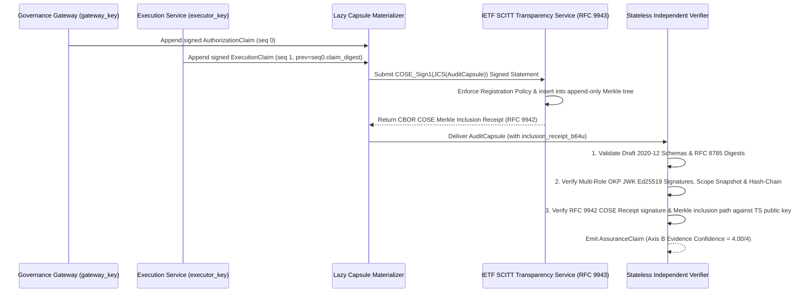

# IETF SCITT (RFC 9943 / RFC 9942) Transparency Interoperability Profile — CIAF-LCM v0.1

**Document ID**: `CIAF-LCM-PROFILE-SCITT-v0.1`  
**Normative References**: IETF SCITT Architecture (*An Architecture for Trustworthy and Transparent Digital Supply Chains*, `RFC 9943`, June 2026), CBOR Object Signing and Encryption (COSE) Receipts (`RFC 9942`, June 2026), CBOR Object Signing and Encryption (`RFC 9052 / COSE_Sign1`), JSON Canonicalization Scheme (`RFC 8785`), Internet X.509 PKI Time-Stamp Protocol (`RFC 3161`)  
**Status**: Normative Technical Profile (`v0.1.1` — Public Comment Draft through February 10, 2027)  
**License**: Creative Commons Attribution 4.0 International (`CC-BY-4.0` — see [`LICENSE-SPEC`](../LICENSE-SPEC))

---

## 1. Architectural Motivation: Integrity vs. Completeness

A critical cryptographic distinction governs audit assurance in CIAF-LCM (`CIAF-09`, `CIAF-10`):

1. **What Local Hash-Chaining Proves (`Mid-Chain Tamper Detection`)**:
   Within a CIAF-LCM provenance stream, each receipt commits to its predecessor via `previous_receipt_digest = prior.claim_digest` (`null` at `sequence_number == 0`), where `claim_digest` is computed over the RFC 8785 canonical claim envelope (including its Ed25519 signature). An offline verifier (`CIAF-10`) can deterministically detect:
   - Single-bit mutation of any claim payload or signature;
   - Deletion of an genesis or intermediate receipt (`sequence_number` gap and broken `previous_receipt_digest`);
   - Reordering or splicing of receipts within a presented capsule.

2. **What Local Hash-Chaining CANNOT Prove Alone (`Omission / Split-View / Tail-Truncation`)**:
   If the same infrastructure operator controls the append-only ledger storage and has not anchored the chain externally, that operator could:
   - Truncate the most recent `k` receipts from the tail of a stream (`N-k .. N-1`) before materializing a capsule;
   - Suppress an entire `workflow_trace_id` stream (e.g., hiding a `CIAF-11` security exception stream completely); or
   - Present equivocating forks of a ledger ("split-view attack") to two different auditors.

3. **How IETF SCITT (`RFC 9943` & `RFC 9942`) Closes the Completeness & Trusted-Time Gap**:
   Registering CIAF-LCM claims or `AuditCapsule` digests as **Signed Statements** in an independent **IETF Supply Chain Integrity, Transparency, and Trust (SCITT — `RFC 9943`, June 2026)** Transparency Service binds every registered statement into an append-only Merkle tree backed by verifiable **COSE Receipts (`RFC 9942`, June 2026)**. Once a client or auditor observes a Transparency Service tree head (or cross-gossips tree checkpoints), the operator **cannot omit, backdate, or equivocate** on registered receipts without cryptographic detection.

| Assurance Property | Local RFC 8785 Hash-Chain (`NOT_REGISTERED_LOCAL_CHAIN_ONLY`) | Local Hash-Chain + IETF SCITT (`REGISTERED_INCLUSION_RECEIPT_ATTACHED`) |
| :--- | :---: | :---: |
| Single-byte payload/signature tamper detection | **Yes** | **Yes** |
| Dual-Key Gateway vs. Executor role enforcement | **Yes** | **Yes** |
| Mid-chain receipt deletion or reorder detection | **Yes** | **Yes** |
| Tail-truncation detection (last receipt dropped) | **No** (unless tip anchored externally) | **Yes** (Merkle checkpoint consistency) |
| Whole-trace suppression / equivocation resistance | **No** | **Yes** (Registration policy + Merkle inclusion) |
| Independent trusted wall-clock timestamp anchoring | **No** (Relies on Gateway/Executor clocks unless RFC 3161 TSA used) | **Yes** (Transparency Service registration timestamp in receipt) |
| Maximum `Evidence Confidence` Axis Score | **`3 / 4`** | **`4 / 4`** |

---

## 2. Mapping CIAF-LCM Claims to SCITT Signed Statements (`COSE_Sign1`)

Per **IETF SCITT (`RFC 9943`)** and **COSE (`RFC 9052`)**, an issuer submits a `Signed_Statement` structured as a `COSE_Sign1` object (`CBOR Tag 18`) to a SCITT Transparency Service. CIAF-LCM v0.1 defines two interoperable registration granularities:

- **Mode A — Per-Receipt Registration (High-Assurance Real-Time)**: Every `AuthorizationClaim` (`issuer = gateway_id`) and `ExecutionClaim` (`issuer = executor_id`) is wrapped as a `COSE_Sign1` Signed Statement upon emission.
- **Mode B — Per-Capsule Checkpoint Registration (Low-Overhead Batch/Lazy)**: Individual claims chain locally on the hot path, and the canonical `AuditCapsule` (or periodic ledger checkpoint) is wrapped and registered as a `COSE_Sign1` Signed Statement.

### 2.1 Normative `COSE_Sign1` Protected Header Parameters

| Header Parameter | COSE Label / Value | Normative Requirement in CIAF-LCM SCITT Profile |
| :--- | :--- | :--- |
| **`alg` (Algorithm)** | Label `1`: `-8` (`EdDSA` / Ed25519) | `MUST` be `-8` (`EdDSA` over Curve25519 / Ed25519 per RFC 8152 / RFC 9053). |
| **`kid` (Key Identifier)** | Label `4`: `bstr` (UTF-8 bytes of `key_id`) | `MUST` match `key_id` in the CIAF-LCM OKP JWK `public_key_manifest`. |
| **`content_type`** | Label `3`: `"application/ciaf-lcm+json"` | `MUST` declare canonical UTF-8 RFC 8785 JSON payload media type. |
| **`CWT_Claims` (`iss`, `sub`)** | Label `15` (`RFC 9597` / `RFC 9943`):<br/>• `iss` (`1`): Gateway/Executor URI<br/>• `sub` (`2`): `workflow_trace_id` | `MUST` bind SCITT Registration Policy issuer (`gateway_id` or `executor_id`) and trace subject (`workflow_trace_id`) inside protected headers so the Transparency Service can enforce issuer admission policies prior to tree insertion. |

### 2.2 `COSE_Sign1` Payload Construction

1. The `COSE_Sign1` payload (`bstr`) `MUST` be the exact **RFC 8785 canonical UTF-8 byte sequence** of the CIAF-LCM `AuthorizationClaim`, `ExecutionClaim`, or `AuditCapsule` (never pretty-printed JSON with arbitrary whitespace).
2. Where privacy or data-minimization regulations apply (such as HIPAA ePHI under Healthcare Readiness Profile `4.1`), issuers `MUST NOT` publish unsalted hashes of low-entropy regulated fields (e.g., MRNs, dates of birth, ICD-10 codes) to external logs. Instead, issuers `MUST` submit a detached/redacted envelope (`content_type: "application/ciaf-lcm-digest+json"`) binding `>= 128-bit` salted commitments (`jcs_salted_commitment`) or keyed `HMAC-SHA256` commitments (`jcs_hmac_sha256`), retaining the salt or HMAC key inside access-controlled `AuditCapsule` storage while preserving external SCITT non-omission and timestamp proofs.

---

## 3. SCITT Inclusion Receipt Binding in `AuditCapsule`

When a SCITT Transparency Service accepts a `Signed_Statement`, it returns a CBOR-encoded **SCITT Receipt** (`COSE_Sign1` counter-signed by the Transparency Service over a verifiable Merkle tree inclusion proof formatted per **IETF `RFC 9942` COSE Receipts** and **`RFC 9943`**).

In `audit-capsule.v0.1.schema.json`, this receipt binds into `scitt_transparency`:

```json
"scitt_transparency": {
  "status": "REGISTERED_INCLUSION_RECEIPT_ATTACHED",
  "transparency_service_id": "did:web:scitt.audit-consortium.example",
  "cose_sign1_statement_digest": "sha256:9f86d081884c7d659a2feaa0c55ad015a3bf4f1b2b0b822cd15d6c15b0f00a08",
  "inclusion_receipt_b64u": "hEShATgioFkB...",
  "completeness_guarantee": "COSE Merkle inclusion receipt (RFC 9942) from IETF SCITT (RFC 9943) Transparency Service provides externally verifiable append-only completeness and registration timestamping."
}
```

When SCITT registration is not configured (`status == "NOT_REGISTERED_LOCAL_CHAIN_ONLY"`), `transparency_service_id`, `cose_sign1_statement_digest`, and `inclusion_receipt_b64u` `MUST` be `null`, and `IndependentVerifier` `MUST` set `checks.scitt_inclusion_verified = null` alongside an explicit `completeness_notice` stating that local hash-chaining verifies mid-chain integrity and issuer-clock consistency, whereas tail non-omission and defense against compromised-executor clock backdating require external `RFC 3161` TSA or IETF SCITT (`RFC 9943` / `RFC 9942`) anchoring.

---

## 4. End-to-End SCITT Verification Sequence (`CIAF-10` + `RFC 9943` / `RFC 9942`)



